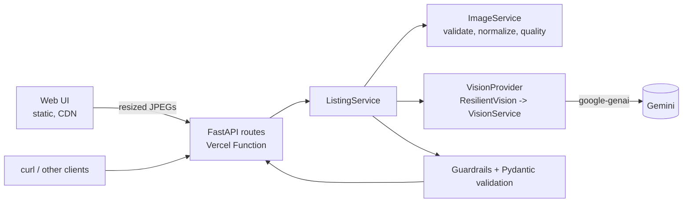
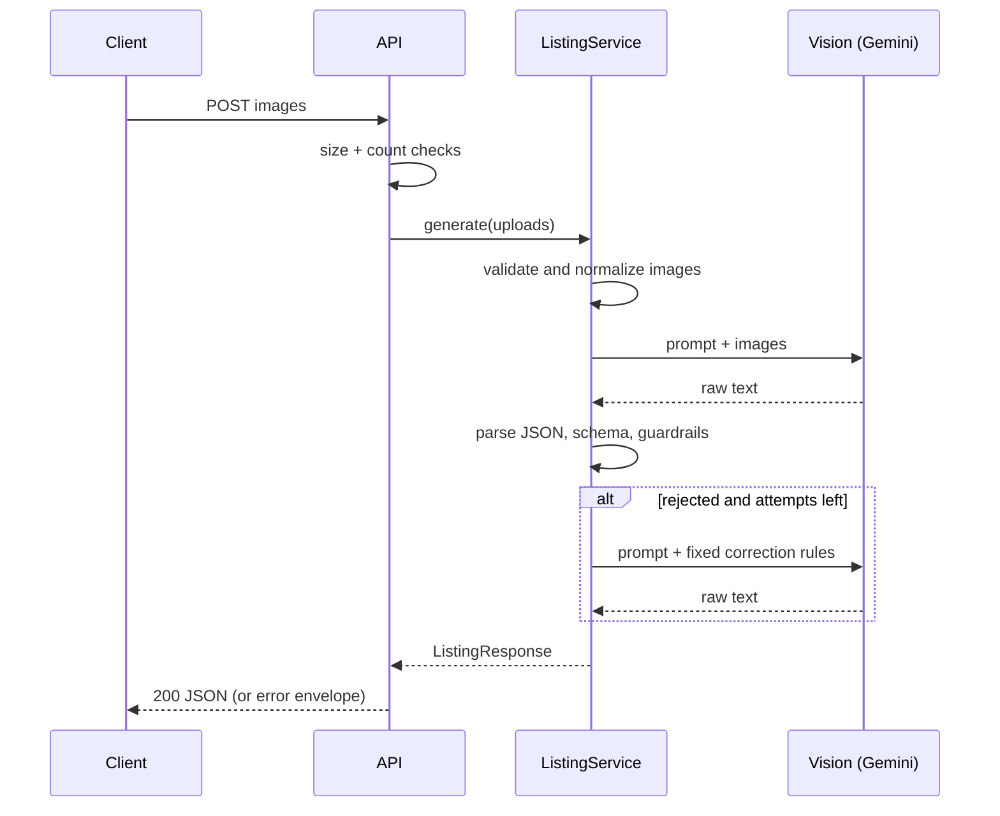
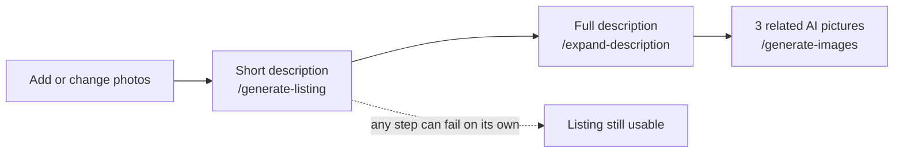

# Vision Cart: AI Marketplace Listing Generator


Upload one or more photos of a product and get a **single, schema-validated marketplace listing**
(title, description, category, condition, features, tags). Built with FastAPI and Gemini Vision, with
a fast, dependency-free web UI on top. Deploys to Vercel in a few minutes (see [Deploy to Vercel](#deploy-to-vercel)).

The design goal is **honesty over fluency**: the service never invents specs, brands, accessories,
warranty or working condition, and it never returns model output that has not passed validation.

## What's new in 1.2 (production deployment)
* **Vercel-ready:** FastAPI runs as a Vercel Function (`app/main.py`, zero-config) and the UI is static files in `public/` served from the CDN. `vercel.json` sets the function timeout, security headers and a strict Content-Security-Policy.
* **Streamlit UI replaced** by a static web app (plain HTML/CSS/ES modules, no build step) with the same flow, plus accessibility (ARIA tabs, live regions, keyboard support) and mobile layout. Streamlit cannot run on Vercel's serverless platform.
* **Photos are resized in the browser** before upload (max 1568 px JPEG, total under 3.8 MB) so requests stay under Vercel's 4.5 MB body limit, and uploads are faster on mobile data.
* **Abuse protection:** per-client rate limit (`RATE_LIMIT_PER_MINUTE`), optional CORS allow-list, security headers on every response, `Cache-Control: no-store` on API responses.
* **Leaner install:** `requirements.txt` is runtime-only (this is what Vercel installs); dev/test tools moved to `requirements-dev.txt`. CI workflow added.

## What's new in 1.1
* **New brand and UI:** Vision Cart, a clean responsive interface with a logo, loading states and a guided flow. No API address, key or settings panel is ever shown to users.
* **Short, then full description:** the listing starts with a short, verified description. The system can then expand it into a longer marketplace description (automatically or on a button), using only facts already in the listing.
* **Related AI pictures:** each time photos are added or changed, three related pictures are generated (studio view, alternate angle, in context). They are **always labelled "AI-generated"**, both in the UI and burned into the image, because they are illustrations, not photos of the real item.
* New endpoints `POST /api/v1/expand-description/` and `POST /api/v1/generate-images/`; both are optional and can be switched off.

## Features
* `POST /api/v1/generate-listing/`: 1-6 images (JPG/PNG/WEBP) of the *same* product -> one listing.
* Strict Pydantic output: fixed category and condition taxonomies, title <= 70 chars, 5-8 lowercase tags.
* Image pipeline: format sniffing, EXIF rotation, RGB flattening, resize to 1568 px, JPEG re-encode.
* Advisory quality checks (dark / blurry / low-res). If **every** image is poor, condition is forced to `Unable to Determine`.
* Deterministic guardrails on model text (hype, warranty, "fully functional", accessory claims, storage/RAM/battery numbers), with a retry that tells the model which rule it broke.
* Resilience: per-call timeout, overall request deadline, bounded retry on transient errors, concurrency cap.
* Uniform error envelope; no stack traces, provider messages or keys ever reach a client.
* Structured JSON logs with a per-request ID (`X-Request-ID`).

## Architecture


Only `VisionService` imports the Gemini SDK, so swapping providers means writing one class.

### Request flow


## How the UI flow works

Each stage shows its own loading state. If the full description or the pictures fail, the listing stays on screen with a retry button.

## Quick start (local)
Requires Python 3.10+ (3.12 recommended) and a Gemini API key from <https://aistudio.google.com/apikey>.

```powershell
git clone <your-repo-url> ai-marketplace-listing
cd ai-marketplace-listing
python -m venv .venv
.\.venv\Scripts\Activate.ps1
pip install -r requirements-dev.txt
Copy-Item .env.example .env
notepad .env          # set GEMINI_API_KEY
python -m scripts.list_models   # optional: confirm which model names your key can use
uvicorn app.main:app --reload
```
macOS/Linux: `source .venv/bin/activate` and `cp .env.example .env`.

Open <http://127.0.0.1:8000> for the UI. Locally the same server also hosts the static UI from `public/`.
API docs: <http://127.0.0.1:8000/docs> (only when `ENABLE_DOCS=true`) | Health: <http://127.0.0.1:8000/health>

### Call the API directly
```powershell
curl.exe -s -F "images=@sample_images\phone.jpg" -F "images=@sample_images\phone_back.jpg" http://127.0.0.1:8000/api/v1/generate-listing/
```
Keep the **trailing slash** (without it the server answers with a 307 redirect).

### Docker
```powershell
docker build -t vision-cart .
docker run --rm -p 8000:8000 --env-file .env vision-cart
```
The image contains no secrets; the key comes from `--env-file`. It runs as a non-root user and has a health check, and serves both the API and the UI on port 8000.
> The Dockerfile was updated for 1.2 but **could not be built in the authoring sandbox** (no Docker daemon). Please run the two commands above once and report any issue.

## Deploy to Vercel
Short version (full walkthrough, checklist and troubleshooting in [`DEPLOY.md`](DEPLOY.md)):
1. Push this folder to a GitHub repository (`.env` is git-ignored; never commit your key).
2. In Vercel: **Add New → Project → import the repo**. Leave the framework preset on **FastAPI** (auto-detected) and don't set a build or output command.
3. Add environment variables (Production + Preview): `GEMINI_API_KEY` (required), `ENABLE_DOCS=false`, and optionally `GEMINI_MODEL`, `GEMINI_IMAGE_MODEL`, `RATE_LIMIT_PER_MINUTE`.
4. Deploy. Open the URL, add a photo, and check `https://<your-app>/health`.

CLI alternative: `npm i -g vercel`, then `vercel` (preview) and `vercel --prod`.

## API
Full schema: [`docs/openapi.json`](docs/openapi.json) (regenerate with `python -m scripts.export_openapi`).

**Success `200`**
```json
{
  "detected_item": "Samsung Tablet",
  "category": "Mobiles and Tablets",
  "condition_estimate": "Unable to Determine",
  "suggested_title": "Samsung Tablet - Silver",
  "suggested_description": "Silver tablet with a visible Samsung logo on the rear panel.",
  "extracted_features": ["Samsung logo on rear", "Silver back panel"],
  "tags": ["samsung", "tablet", "silver", "touchscreen", "android"]
}
```
Categories: Electronics, Mobiles and Tablets, Fashion, Vehicles, Home and Living, Tools and Industrial.
Conditions: Brand New, Like New, Used - Good Condition, Used - Fair Condition, Poor Condition, Unable to Determine.

**`POST /api/v1/expand-description/`** (JSON body = the listing fields) returns `{"long_description": "..."}`. The text may only use facts from the request; any number that was not in the input is rejected, and all listing guardrails apply.

**`POST /api/v1/generate-images/`** (same multipart `images` as above, optional form field `detected_item`) returns `{"images": [{"label", "mime_type", "data_base64", "ai_generated": true}], "notice": "..."}`. Partial results are returned if some pictures fail; an error is returned only if all fail.

**Errors** always look like `{"error": {"code", "message", "request_id"}}`:

| HTTP | code | Meaning |
|---|---|---|
| 400 | `invalid_image` | Missing, unreadable, corrupt or unsupported image, or too many images |
| 413 | `image_too_large` / `request_too_large` | A file or the whole request exceeds the limit |
| 422 | `no_product_detected` | The model found no sellable product (landscape, screenshot, ...) |
| 422 | `ai_output_invalid` | Model output failed schema/guardrails after all attempts |
| 429 | `vision_rate_limited` | Provider quota; `Retry-After: 30` is set |
| 503 | `vision_unavailable`, `vision_timeout`, `vision_empty_response`, `request_timeout` | Provider or deadline problem; retry |
| 503 | `vision_misconfigured` | Bad API key or model name (check `.env`) |

## Configuration
All settings are environment variables (or `.env`); see [`.env.example`](.env.example) for the full list.
Common ones: `GEMINI_API_KEY` (required), `GEMINI_MODEL`, `API_TIMEOUT` (per provider call, 60 s),
`REQUEST_TIMEOUT` (whole request, 110 s), `MAX_IMAGES_PER_REQUEST`, `MAX_IMAGE_SIZE_MB`,
`BLOCK_UNVERIFIED_SPECS`, `LOG_LEVEL`. Also: `RATE_LIMIT_PER_MINUTE` (default 20, 0 = off), `CORS_ORIGINS` (empty = same-origin only). Since 1.1: `GEMINI_IMAGE_MODEL` (run `python -m scripts.list_models` to find an image-capable model your key can use), `GEMINI_TEXT_MODEL`, `ENABLE_IMAGE_GENERATION`, `ENABLE_DESCRIPTION_EXPANSION`, `RELATED_IMAGE_COUNT`, `WATERMARK_GENERATED_IMAGES`, `ENABLE_DOCS`.
Each related picture is a separate model call: turn `ENABLE_IMAGE_GENERATION` off or lower `RELATED_IMAGE_COUNT` to control cost.

## Edge cases and failure behaviour
Handled without crashing or inventing data (details and per-case results in [`evaluation/EDGE_CASES.md`](evaluation/EDGE_CASES.md)):
corrupt/truncated/zero-byte files, wrong extension or MIME, oversized files and dimensions, EXIF-rotated and
transparent images, blurry/dark/low-resolution images (condition downgraded), no-product images, multiple
products (dominant item only), provider outage, rate limiting, timeouts and empty responses.

## Testing
```powershell
pip install -r requirements-dev.txt
pytest -q
node tests/js/frontend.test.mjs
```
184 Python tests plus a Node test for the browser API client (`node tests/js/frontend.test.mjs`); the vision provider is always mocked, so no key or network is needed.
Offline robustness check: `python -m scripts.edge_cases`.

## Evaluation
```powershell
python -m scripts.run_evaluation --dry-run   # which cases have images
python -m scripts.run_evaluation             # live run, writes evaluation/REPORT.md + results.json
```
See [`evaluation/REPORT.md`](evaluation/REPORT.md) for current results and limitations, and
[`evaluation/images/README.md`](evaluation/images/README.md) for the photos you need to supply.

## Demo
[`docs/DEMO.md`](docs/DEMO.md): a step-by-step 4-product demo including failure cases.

## Project layout
```
app/            FastAPI app: api/ (routes, errors, middleware, security), core/, models/, prompts/, services/
public/         Static web UI (index.html, assets/*.js|css, logo) served by the Vercel CDN
scripts/        baseline, samples, edge cases, evaluation, model listing, OpenAPI export
evaluation/     dataset, metrics, report, images
tests/          pytest suite (+ tests/js for the browser API client)
docs/           OpenAPI export, demo guide
vercel.json     function duration, security headers, CSP
.github/        CI workflow
```

## Security notes
* The key is a `SecretStr` read from the environment; it is never logged or returned. `.env` is git- and docker-ignored.
* Treat any text inside user photos as data: the prompt tells the model not to follow it. This reduces, but cannot eliminate, prompt-injection risk.
* The API has no user authentication: anyone with the URL can spend your Gemini quota. Mitigations built in: per-client rate limiting, request size caps, no keys in the browser. Strongly recommended on top: a Vercel Firewall rate-limit rule on `/api/*`, a **spend/quota cap in Google AI Studio**, and Vercel's Deployment Protection (or your own login) if the app is not meant to be public.
* The rate limiter is in-memory and therefore per serverless instance; it is a courtesy brake, not a hard guarantee.
* Every response carries security headers; the UI ships with a strict CSP (no inline scripts or styles) and never inserts model text as HTML.

## Known limitations
* Generated pictures can invent unseen details (for example the back of a device). They are labelled as AI illustrations and must not be passed off as real photos of the item.
* The image model name and quota depend on your Gemini account; the default `gemini-3.6-flash-image` is unverified. If it is wrong, the UI shows that visuals are unavailable and the listing still works.
* One listing per request; photos of several different products are not split.
* Condition is an estimate from photos, and is often `Unable to Determine` for clean catalog-style shots.
* Vercel function bodies are capped at 4.5 MB: the web UI compresses photos to fit, but direct API clients must keep the whole request under that size.
* The UI cannot read HEIC/HEIF photos (browsers can't decode them); iPhone users should export as JPEG or use "Most Compatible" camera format.
* Quality thresholds were tuned on synthetic images; calibrate them on your own photos.
* Guardrails are regex-based and English-only.
